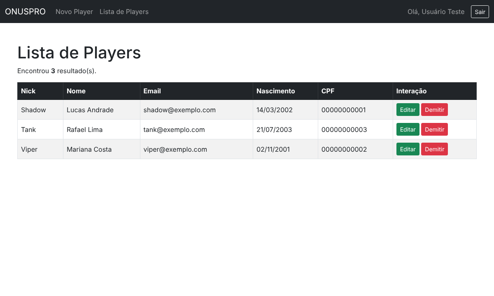
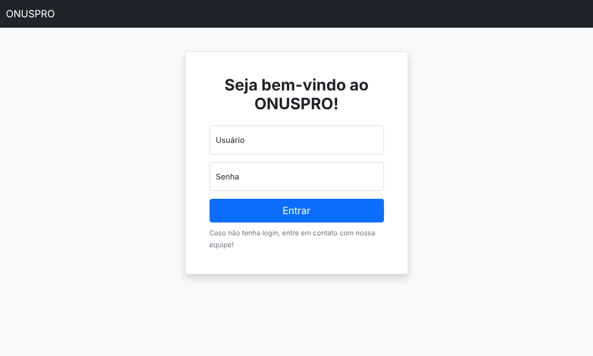
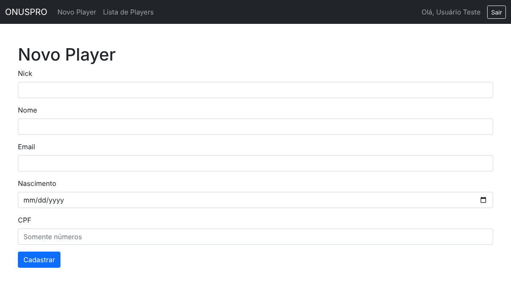

# ONUSPRO – Player Management

> Painel web para organizações de eSports gerenciarem os jogadores da sua line oficial.
> Projeto Integrado do curso de Sistemas de Informação (Faculdade Projeção, 2022). Foi a primeira versão da ideia que depois virou o meu TCC, o [ONUSPRO](https://github.com/eduardoGuerra56/onuspro).




**Vídeo de demonstração:** [assistir no YouTube](https://www.youtube.com/watch?v=Flc3UOW0sSE) (apresentação da versão original de 2022).

## O problema

Na hora de inscrever o time num campeonato, muitas organizações precisam juntar às pressas os dados de cada jogador (nick, nome, e-mail, nascimento e CPF) e acabam perdendo o prazo de inscrição. O sistema guarda esses dados num só lugar, prontos para consulta.

## Funcionalidades

- **Login** de gestores com senha em hash (`password_hash`) e sessão protegida
- **CRUD de players:** cadastrar, listar, editar e remover ("demitir") jogadores
- **Validações:** CPF com 11 dígitos, e-mail válido e aviso de CPF duplicado
- **Segurança:** consultas com *prepared statements* (proteção contra SQL injection), saída escapada contra XSS e páginas internas acessíveis só com login

| Login | Novo player |
| --- | --- |
|  |  |

## Tecnologias

- **PHP 8** com MySQLi
- **MySQL 8**
- **Bootstrap 5** para a interface
- **Docker Compose** para subir o ambiente com um comando

## Estrutura

```
onuspro-player-management/
├── src/
│   ├── login.php           # Autenticação do gestor
│   ├── auth.php            # Proteção das páginas internas
│   ├── index.php           # Layout e roteamento (?page=...)
│   ├── lista.php           # Listagem dos players
│   ├── player.php          # Formulário de cadastro
│   ├── editar-player.php   # Formulário de edição
│   ├── salvar-player.php   # Cadastrar, editar e excluir
│   └── config.php          # Conexão com o banco
├── database/schema.sql     # Tabelas e dados de exemplo
├── Dockerfile
└── docker-compose.yml
```

## Como executar

### Com Docker (recomendado)

```bash
git clone https://github.com/eduardoGuerra56/onuspro-player-management.git
cd onuspro-player-management
docker compose up --build
```

Acesse http://localhost:8080/login.php e entre com **usuário `teste`** e **senha `teste`**.

### Com XAMPP / WAMP

1. Importe `database/schema.sql` no phpMyAdmin (ele cria o banco `onuspro`).
2. Copie o conteúdo de `src/` para a pasta `htdocs/onuspro`.
3. Se o seu MySQL tiver senha, ajuste `src/config.php`.
4. Acesse http://localhost/onuspro/login.php.

## Autor

**Eduardo Guerra** – Analista de Suporte | Bacharel em Sistemas de Informação

[](https://github.com/eduardoGuerra56)
